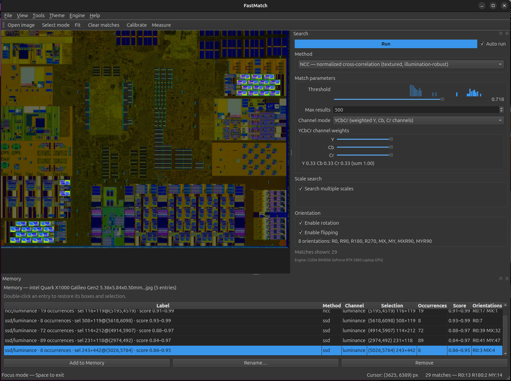

# FastMatch

[English](README.md) | [简体中文](readme_cn.md)



FastMatch 是一个基于 PySide6 的单进程桌面应用，用于浏览**十亿像素级图像**，
并查找其中重复出现的视觉图案。它将图像加载到采用分块、GPU 合成的视口中
（滚轮以光标为中心缩放、拖动平移、左键拖动选择区域），对你框选的区域进行
快速模板搜索，然后在图像中标出所有其他相似区域。
默认匹配算法为**归一化互相关（NCC）**，也可以在下拉菜单中选择其他**匹配方法**：
SSD 适用于平坦或纹理较少的区域，CCORR 提供另一种相关性度量，特征匹配则适用于
旋转、缩放或变形后的实例（参见[匹配方法](#匹配方法)）。
相关性匹配方法基于 PyTorch，支持 NVIDIA CUDA、AMD ROCm 和 Apple MPS；
加速器不可用时会回退到 CPU。
如果需要类似图像搜索引擎的相似性搜索，可选择 **Fuzzy instance search**（模糊实例搜索）
查找外观改变的副本，或选择 **Semantic similarity**（语义相似度）查找视觉上相关的对象。
参见[模糊与语义搜索](#模糊与语义搜索)。

---

## 安装

### 下载可执行程序

带版本标签的提交会在 [GitHub Releases](https://github.com/AL-255/fastmatch/releases)
生成独立应用。解压后运行应用无需安装 Python。

| 平台 | 构建版本 |
|---|---|
| Windows x64 | CPU、NVIDIA CUDA 12.8 |
| Linux x64（Ubuntu 22.04 或更新版本 / 兼容的桌面系统） | CPU、NVIDIA CUDA 12.8、AMD ROCm 7.2 |
| macOS Apple Silicon | Apple MPS GPU，不可用时回退到 CPU |

选择适合硬件的版本，解压并保留完整文件夹。Windows 启动 `FastMatch.exe`，
macOS 启动 `FastMatch.app`，Linux 启动 `FastMatch/FastMatch`。
**Auto** 自动选择可用的加速器；**Engine** 菜单也提供 CPU、CUDA/ROCm 和 Apple MPS。
CUDA/ROCm 版本需要兼容的 GPU 驱动。macOS 版本采用临时签名，尚未公证；Windows 版本未签名。
语义模型已包含在应用中，可离线使用。

较大的 GPU 压缩包会分为 `.part001`、`.part002` 等文件。
请将所选版本的**全部**分片及 `.parts.json` 清单下载到同一文件夹。
发布页面提供合并分片并验证 SHA256 的脚本：

```bash
python assemble_release.py FastMatch-vX.Y.Z-linux-x64-rocm7.2.tar.gz.parts.json
```

Windows 可使用 PowerShell 脚本，无需 Python：

```powershell
./assemble_release.ps1 -Manifest FastMatch-vX.Y.Z-windows-x64-cuda-cu128.zip.parts.json
```

合并后再解压。每个构建还附带 `.sha256` 校验文件和打包应用的冒烟测试报告。
本地构建及版本标签触发的工作流程参见[发布构建](docs/RELEASING.md)。

### 从源码运行

FastMatch 需要 PySide6、NumPy、Pillow 和 PyTorch。**torchvision 是可选依赖**
（仅用于稍快一些的非极大值抑制；引擎自带纯 PyTorch 实现作为备用），
**OpenCV 也是可选依赖**——严格特征匹配和模糊实例搜索需要它
（参见[匹配方法](#匹配方法)）；NCC / SSD / CCORR 均不使用 OpenCV。
通过 `requirements.txt` 快速安装时，会安装 `-headless` 版 OpenCV，避免与 PySide6 的 Qt 插件冲突。

### CPU 快速安装

```bash
pip install torch==2.11.0 --index-url https://download.pytorch.org/whl/cpu
pip install -r requirements.txt
```

先从 PyTorch CPU 索引安装，可以在 Windows/Linux 上明确选择**仅支持 CPU** 的运行时
（macOS wheel 也包含 MPS 支持），再安装其他依赖。
应用在 CPU 上具备完整功能，所有代码路径均兼容不同计算设备，只是在大规模多尺度搜索时速度较慢。

### GPU 升级（CUDA / cu128）

如需 NVIDIA 加速，请将 CPU 运行时替换为已测试的 CUDA 12.8 版本。
CUDA 可用标志不能单独保证驱动和 GPU 架构兼容；FastMatch 启动时还会执行探测内核。

```bash
pip install --force-reinstall torch==2.11.0 --index-url https://download.pytorch.org/whl/cu128
```

验证 GPU 构建版本是否已启用：

```bash
python -c "import torch; print(torch.cuda.is_available())"
```

- 使用 **CPU** wheel 包时，输出为 `False`。
- 使用**可正常工作的 CUDA** wheel 包时，输出为 `True`，FastMatch 的状态提示会显示
  `Engine: CUDA (<你的 GPU 名称>)`，而不是 `Engine: CPU (slow) …`。

FastMatch 会在运行时通过 `torch.cuda.is_available()` 和启动时的**探测内核**共同检测设备。
如果 CUDA wheel 包损坏或不匹配，应用会自动回退到 CPU，避免崩溃。

Linux 上的 AMD GPU 可安装 ROCm 运行时。Apple Silicon 使用普通 macOS PyTorch
wheel 中的 MPS 支持，并通过独立的探测内核检查：

```bash
pip install --force-reinstall torch==2.11.0 --index-url https://download.pytorch.org/whl/rocm7.2
```

---

## 运行

```bash
# 在查看器中打开图像
python -m fastmatch path/to/image.png

# 不指定图像启动，初始显示空白画布；通过
# File > Open Image… 打开图像
python -m fastmatch

# 生成带有已知匹配目标的合成测试图像（纹理噪声 + 已知图案），然后打开
python -m fastmatch --generate-sample sample.png --w 12000 --h 12000
python -m fastmatch sample.png

# 指定设备（auto 依次尝试 CUDA/ROCm、Apple MPS、CPU）
python -m fastmatch path/to/image.png --device cpu
python -m fastmatch path/to/image.png --device cuda
python -m fastmatch path/to/image.png --device rocm
python -m fastmatch path/to/image.png --device mps
python -m fastmatch path/to/image.png --device auto
```

不提供图像路径时，FastMatch 会显示**空白画布**（不会自动生成演示图像），
可通过 *File ▸ Open Image…* 加载图像。`--device` 接受 `auto`、`cuda`、`rocm`、`mps` 或 `cpu`。
CUDA/ROCm 和 Apple MPS 均通过实际内核探测后启用；不可用的加速器会回退到 CPU。
即使指定 `cuda`，探测内核失败时仍会回退到 CPU。
`--generate-sample <path>` 会生成包含一组已知图案的合成图像并退出
（默认尺寸为 `12000x12000`，可通过 `--w` / `--h` 修改）；需要另行加载该文件进行搜索。

---

## 操作指南

| 操作 | 效果 |
|---|---|
| **滚轮** | 放大或缩小，始终以**光标位置**为中心（最大 64 倍）。画布视为无限延伸，因此即使在图像边缘，光标仍是缩放中心。 |
| **F** | 缩放以显示整张图像。 |
| **按住空格并拖动**，或**鼠标中键拖动** | 平移视图。 |
| **鼠标左键拖动** | 绘制选框，作为搜索模板。 |
| **Run** 按钮 / **Auto Run** 复选框 | 开启 *Auto Run*（默认）后，每次框选或修改设置都会执行搜索。关闭后可先调整选区和参数，再点击 **Run** 执行一次搜索，适合单次搜索耗时较长的情况。 |
| **Channel 下拉菜单** | 选择匹配评分使用的颜色空间：`luminance`（单个 BT.601 亮度平面）、`rgb` 或 `ycbcr`。两种彩色模式采用**多通道**匹配（各通道分别计算相关性），并提供**各通道权重滑块**（R、G、B 或 Y、Cb、Cr）。参见[通道模式与权重](#通道模式与权重)。 |
| 完成新的框选 | 开启 Auto Run 时执行搜索；正在进行的搜索会**自动取消**，以最新选区为准。 |
| **Method 下拉菜单** | 选择 NCC / SSD / CCORR、Fuzzy instance search、Semantic similarity 或 Strict feature matching。修改后会对当前选区**重新搜索**。参见[匹配方法](#匹配方法)。 |
| **Rotation / Flipping 复选框** | 额外搜索模板的 90° 整数倍旋转和/或镜像版本。修改任一选项都会**重新搜索**。参见[方向搜索](#方向搜索)。 |
| **Threshold 滑块** | **实时筛选**显示结果，无需重新搜索，适用于所有方法。 |
| **View ▸ Match boxes 菜单** | 配置匹配框轮廓：**Line width**（线宽，1–6 像素，不随缩放变化）和 **XOR with background**（对背景进行异或反色，使轮廓在任何背景上都清晰可见）。 |
| **Engine 菜单** | 切换 **Auto (prefer GPU)**、按已安装运行时显示的 **CUDA (NVIDIA GPU)** 或 **ROCm (AMD GPU)**、**MPS (Apple GPU)** 和 **CPU**。不可用的加速器会置灰。切换会重建引擎、更新状态提示和多尺度控制项，并重新搜索当前选区。 |
| **Theme 菜单** | 切换外观：**System**（跟随桌面）、**Light** 或 **Dark**。界面和图像画布会立即更新主题，并记住选择供下次启动使用。 |
| **Tools 菜单** | **Calibrate scale**（标定比例）和 **Measure distance**（以物理单位测量距离）。参见[测量与标定](#测量与标定)。 |
| **Add to Memory** | 将当前选区及全部当前匹配结果保存为 Memory 列表中的条目。参见[匹配结果存档（Memory）](#匹配结果存档memory)。 |
| **双击 Memory 条目** | 重新查看保存的搜索：恢复蓝色参考框到保存的选区，并重新显示其匹配结果。 |

匹配结果会**排除你选择的源区域**（否则它始终是完美的自匹配），界面也会提示这一排除行为。
过小（任一边小于 8 像素）、几乎覆盖整张图像或过于狭长（长宽比大于 20）的选区会被拒绝。

---

## 匹配原理简介

FastMatch 在 GPU（或 CPU）上计算所选模板与整张图像之间的**归一化互相关**。
NCC 对亮度和对比度变化具有不变性，因此能容忍重复实例之间常见的光照差异。主要特点：

- **多尺度：**在多个尺度上匹配模板（GPU 使用较宽的尺度网格，CPU 使用单一尺度以保持响应速度）。
  汇总所有尺度的候选结果后，统一执行全局**非极大值抑制（NMS）**，为每个位置保留最佳尺度。
- **默认不搜索旋转。**一般情况下会漏掉旋转后的实例，除非主动启用旋转搜索
  （计算成本会随搜索角度数量成倍增加）。
- **可能漏掉尺度网格之外的实例。**明显大于或小于扫描尺度范围的实例可能无法找到；此时应扩大尺度范围。
- 匹配在单个后台工作线程上执行，支持协作式取消，并采用 120 毫秒防抖，
  因此拖出新的选框可以顺畅地替换之前的搜索。

---

## 匹配方法

“完全平坦”的区域和“发生变形”的区域需要不同的匹配算法。
FastMatch 可通过参数面板中的 **Method 下拉菜单**选择算法。
修改方法会对当前选区重新搜索；对于所有方法，阈值滑块始终只在客户端实时筛选结果，无需重新搜索。

| 方法 | 原理 | 适用场景 | 运行设备 |
|---|---|---|---|
| **NCC**（默认） | 归一化互相关（CCOEFF）。减去均值，并根据各窗口的方差进行归一化，因此**能适应光照变化**。 | **有纹理、方向一致、尺度相同**的实例，适合作为通用默认方法。模板内部需要一定纹理以便归一化。 | **GPU**（可回退到 CPU） |
| **SSD** | 归一化平方差：逐像素差值的 `1 − RMSE`。 | **平坦、纹理较少或外观完全一致**的区域，此时 NCC 的方差归一化不稳定，甚至会直接拒绝模板。**不具备**光照不变性，适合亮度一致的情况。 | **GPU**（可回退到 CPU） |
| **CCORR** | 余弦互相关（CCORR_NORMED），不减去均值的另一种相关性度量。 | NCC 的替代相关性方法；NCC 表现异常时，可用来交叉检查。 | **GPU**（可回退到 CPU） |
| **Fuzzy instance search**（模糊实例搜索） | RootSIFT 描述子、重复实例检索和针对各实例的 RANSAC 几何验证。根据描述子相似度、关键点覆盖率及几何一致性评分，不使用像素相关性作为硬性门槛。 | 有独特局部细节的**模糊、压缩、重着色或部分遮挡**副本，也适用于旋转、缩放和透视变化。 | **CPU**，通过 OpenCV |
| **Semantic similarity**（语义相似度） | 使用预训练 DINOv2 特征，对重叠窗口计算余弦相似度，再进行局部位置优化。 | **外观不同但视觉上相关的对象**，包括没有对应关键点的区域。 | **GPU 或 CPU**，通过 PyTorch；需要可选的本地模型 |
| **Strict feature matching**（严格特征匹配） | 通过密集的 ORB/AKAZE/SIFT 关键点为每个重复实例**提出候选**（每个副本使用一个对应关系，不采用 Lowe 比率检验），再通过**外观验证**（归一化互相关）确认候选。 | 对齐后像素仍高度相关的**旋转、缩放或透视变形**副本。 | **CPU**，通过 OpenCV |

说明：

- **NCC、SSD 和 CCORR 均支持 GPU 加速**（PyTorch），共用分块、边缘扩展区（halo）、
  多尺度扫描、非极大值抑制、源区域排除、结果数量上限、进度显示与取消机制。
  它们仅在窗口评分公式上不同，因此切换成本很低。
- **NCC 会拒绝接近平坦、缺乏纹理的模板**并显示提示，因为此时方差归一化没有良好定义。
  **SSD 不会拒绝这类模板**，这正是它的适用场景；搜索纯色或纹理极少的目标时，请切换到 SSD。
- **特征匹配通过 OpenCV 在 CPU 上运行**，即使相关性方法正在使用 CUDA 也是如此。
  它在**完整分辨率下密集检测关键点**（通过分块控制内存占用，图像检测结果会缓存，供后续查询复用），
  为每个重复副本提出候选实例，并使用**外观验证**（零均值归一化互相关）确认每个候选，
  使结果与相关性方法保持一致，误报很少。
  它忽略尺度网格（本身能够适应尺度和旋转变化），但**遵循通道模式**：
  关键点*检测*始终使用灰度图（ORB/AKAZE/SIFT 均如此），而在 **rgb / ycbcr** 模式下，
  外观验证会考虑颜色（三通道加权 NCC），适合区分亮度相似但颜色不同的副本。
  面板中提供检测器（ORB / AKAZE / SIFT）和匹配数量控制项。
- 特征匹配需要 **OpenCV**（快速安装会安装 `opencv-python-headless`）。
  未安装 OpenCV 时，下拉菜单中的该选项会置灰并显示提示，其他三种方法仍可正常使用。

---

## 通道模式与权重

**Channel mode 下拉菜单**决定评分使用的颜色空间，适用于
**NCC / SSD / CCORR、严格特征匹配和模糊实例搜索**。
语义相似度始终使用 RGB 学习特征，并禁用这些控制项。

| 模式 | 匹配依据 |
|---|---|
| **luminance**（默认） | 单个 BT.601 亮度平面，速度最快、内存占用最少。 |
| **rgb** | **R、G、B** 三个通道，各自计算相关性，再通过 **RGB 权重滑块**组合。 |
| **ycbcr** | **Y、Cb、Cr** 三个通道（BT.601），通过 **YCbCr 权重滑块**组合。 |

彩色模式采用**多通道**计算：每个通道独立计算相关性，再对各通道分数加权求和，
而不是将颜色投影为单个灰度平面，因此仍能区分颜色差异。
选择 **rgb** 或 **ycbcr** 后，会出现三个**权重滑块**（R/G/B 或 Y/Cb/Cr）。
权重会**归一化，使总和为 1.0**（读数显示归一化后的值），用于控制各通道对总分的贡献。
GPU 相关性方法（NCC/SSD/CCORR）和特征匹配的外观验证均采用相同方式。一些实用设置：

- **相等权重**可复现未加权的多通道行为。
- 在 ycbcr 模式下设置 **Y 权重为 (1, 0, 0)**，与亮度匹配完全一致。
- **偏重色度**的 ycbcr（为 Cb/Cr 分配权重，Y 权重很小或为零）按*颜色*匹配：
  只接受相同颜色的副本，排除仅亮度相同的副本；反之，偏重 Y 则会忽略颜色，按形状匹配。
- 亮度模式仍是成本最低的默认选项。彩色模式需要准备额外的通道平面
  （ycbcr 采用惰性转换，仅在首次使用时生成）。

---

## 方向搜索

默认只搜索模板的**原始、未镜像方向**。
参数面板中的两个复选框可以将搜索扩展到**正方形的 8 种对称变换**（二面体群 D4）：

- **Rotation**：额外匹配旋转 90°、180° 和 270° 的模板。
- **Flipping**：额外匹配镜像模板（水平和垂直翻转）。**同时开启两项**时，
  还会搜索两种对角镜像（镜像**加上** 90° 旋转），覆盖全部 8 个方向。

| Rotation | Flipping | 搜索方向 |
|---|---|---|
| 关闭 | 关闭 | 仅原始方向（默认，与加入此功能前的行为一致） |
| 开启 | 关闭 | 原始方向 + 90° / 180° / 270° |
| 关闭 | 开启 | 原始方向 + 水平 / 垂直镜像 |
| 开启 | 开启 | 全部 8 种（旋转、镜像和对角镜像） |

**全部方法均遵循这些复选框设置。**相关性方法（NCC / SSD / CCORR）
会为每个启用方向重新计算评分图，并在每个位置保留最佳结果。
特征匹配则为每个启用方向提出模板候选，对各实例进行外观验证，并标记匹配到的方向。
每个结果都会记录对应方向，因此匹配目标可以是选区的旋转或镜像副本。
两项都关闭时，行为与前述仅搜索原始方向的方式完全一致，无额外开销。
修改任一复选框都会重新搜索当前选区；阈值滑块仍然只实时筛选结果，无需重新搜索。
模糊搜索对恢复出的几何变换进行方向分类；语义搜索比较所选方向的模板特征，
并在 90° 旋转时调整搜索窗口的长宽比。

---

## 模糊与语义搜索

查找外观改变的副本和查找不同但视觉上相关的对象，需要不同的判断依据，因此提供两种独立模式。

- **Fuzzy instance search** 使用 [RootSIFT](https://www.robots.ox.ac.uk/~vgg/publications/2012/Arandjelovic12/arandjelovic12.pdf)
  和几何验证。图像描述子查询模板索引，因此重复副本不会争抢固定数量的近邻名额。
  **Min matches** 控制独立关键点的支持数量；阈值筛选描述子与几何证据的综合评分。
  如需容忍重着色，请使用亮度模式；RGB/YCbCr 权重会加入颜色直方图相似度。
  算法自动推断尺度，需要独特细节；缺少纹理的简单形状可能没有结果。
- **Semantic similarity** 使用本地 [DINOv2-small](https://github.com/facebookresearch/dinov2)
  权重，对重叠窗口排序、优化有希望的位置并合并重叠结果。CPU 也支持多尺度搜索。
  结果是基于选区尺寸和长宽比的近似区域，而不是对象分割。
  在超大图像中使用小选区需要大量模型调用，可能较慢；仍支持取消和进度显示。
  在具体领域的效果取决于预训练特征。
- 分数表示相似度，**不是概率**，不同方法之间不能直接比较。
  可从 `0.5` 左右开始调整阈值。正样本分别执行搜索；负样本采用所选检索方法的证据，
  不使用像素相关性筛选。两种模式均支持选区掩码、源区域排除、结果数量限制、
  方向搜索和 Memory 存档。

模糊搜索可直接使用常规快速安装。启用语义搜索需要：

```bash
pip install -r requirements-semantic.txt
python -m fastmatch --download-semantic-model
```

显式下载会将模型数据存入 `models/dinov2-small`（Git 忽略该目录）。
之后搜索完全**离线**运行，不上传图像，搜索时也不会下载权重。
依赖和权重未准备好时，该方法会置灰。完成安装后请重新启动应用。
如需指定其他位置，可按以下方式下载和启动：

```bash
python -m fastmatch --download-semantic-model /path/to/dinov2-small
FASTMATCH_SEMANTIC_MODEL=/path/to/dinov2-small python -m fastmatch
```

可复现的 CPU 对比：

```bash
python scripts/fuzzy_eval.py
python scripts/feature_eval.py --method fuzzy
```

默认的合成外观变化场景可找回 **4/4 个副本，无误报**
（严格匹配器找回 3/4，漏掉 50% 遮挡的副本）。独立的旋转/缩放场景可找回
**36/36 个副本，无误报**。这些受控场景用于回归检查，不保证任意图像上的表现。

---

## 匹配结果存档（Memory）

**Memory 面板**保存搜索列表，便于在一次会话中收集、比较感兴趣的匹配结果。

- **Add to Memory**：搜索完成后，点击 *Add to Memory* 添加条目，记录**当前选框**、
  **全部当前匹配结果**及使用的**完整设置**（完整的 `MatchParams`：方法、通道模式、
  阈值、尺度、方向标志、NMS/排除区域的 IoU、最大结果数、计算数据类型及特征匹配参数）。
- **条目统计**：每行显示方法、通道模式、选区、**出现次数**
  （匹配结果数**加上参考选区**，例如 2 个匹配显示为 3 次出现）、分数范围，
  以及简短的方向统计（如 `R0:2 R90:1 MY:1`）；悬停可查看该条目的**全部**设置。
- **Rename…**：为选中条目设置自定义名称（留空会恢复自动摘要）；名称显示在列表中并保存到 JSON。
- **Remove**：从列表中删除选中的行。
- **双击**条目可**重新查看**：FastMatch 会将蓝色参考框恢复到保存的选区，并重新显示其匹配结果。
- **File 菜单**：所有文件操作均位于 **File** 菜单中：*Open Image…*、*Close Image*、
  *Open Memory…*、*Save Memory*（写入当前文件；尚无文件时提示选择路径，`Ctrl+S`）、
  *Save Memory As…*（`Ctrl+Shift+S`）和 *Close Memory*（清空列表）。
  保存时始终写入 `.json` 文件；若输入的名称没有扩展名（如 `patterns`），
  会自动保存为 `patterns.json`。Memory `.json` 记录**源图像**（路径和像素尺寸）
  及**全部条目**（选区、设置，以及每个匹配的分数、尺度和方向）。
  匹配坐标采用**源图像的像素坐标系**，因此在同一图像上打开 Memory 时，框的位置会准确对齐；
  如果存档对应另一张图像，应用会询问是否打开那张图像。
  对于由更新版本 FastMatch 写入的文件（更高的结构版本），或格式错误、非 JSON 文件，
  应用会显示清晰的错误并拒绝加载，避免崩溃。
- **Engine 菜单**：无需重启即可切换计算后端：*Auto (prefer GPU)*、*CUDA (GPU)* 或 *CPU*。
  未检测到可用 GPU 时，CUDA 选项会禁用（使用与启动时相同的探测内核检测），避免选择不可用后端。
  切换时会关闭旧工作线程、在所选设备上重建引擎、更新状态提示、
  重新判断是否启用仅限 GPU 的多尺度搜索，并重新搜索当前选区，效果与启动时指定 `--device` 一致。
  视图、选区和 Memory 列表在切换后保留。
- **Theme 菜单**：运行时可切换应用外观：*System*（跟随桌面主题）、*Light* 或 *Dark*。
  整个窗口和图像画布会立即更新主题。Light/Dark 使用自定义调色板与遵循 Qt 调色板的
  **Fusion** 样式，使各平台外观一致；*System* 恢复启动时捕获的桌面主题。
  选择通过 `QSettings` 保存，并在下次启动首次绘制前应用，避免启动时闪烁。
  匹配框和选框的颜色在各主题中保持一致（匹配框始终显示为相同的绿色）。

---

## 测量与标定

**Tools 菜单**和工具栏支持在像素网格上进行物理尺度测量：

- **Calibrate scale**：点击 *Calibrate*，沿已知物理长度的对象
  （如比例尺或芯片边缘）拖出一条线，按提示输入长度（如 `5.36 mm`；仅输入数字会沿用上次的单位）。
  输入长度对应水平、垂直像素跨度中**较长的一项**（`max(|Δx|, |Δy|)`），
  适用于与某个坐标轴对齐的对象。**第一个点成为物理坐标网格的原点**。
  橙色参考线会保留并标注长度。
- **Measure distance**：点击 *Measure* 后拖出一条线，线旁会以琥珀色标注
  **物理距离**（实际欧几里得长度 × 比例），并在状态栏显示。标定前显示像素距离。
- **光标物理坐标**：标定后，状态栏会在像素坐标旁显示相对于标定原点的物理坐标，
  例如 `(1203, 540) px   (5.36, 2.41) mm`。
- **选区面积**：状态栏显示当前选框的**物理面积**，
  例如 `area 31.3 mm²`（像素面积 `w·h × scale²`）。

两种工具均为单次操作：拖动一次后恢复之前的平移/选择模式。
标定按图像保存，打开或关闭图像时重置；*Clear calibration* 和 *Clear measurement* 可分别清除标定和测量。

---

## 自检

FastMatch 内置正确性检查：

- **Self-test 菜单操作**：合成一张图像，在 N 个位置放置已知图案，运行匹配器，
  并确认能找回所有预置实例（中心误差在 ±1 像素内），同时排除源区域。
- **`--generate-sample` 工作流程**：命令行也提供相同的生成器。
  可生成带有已知匹配目标的图像，打开后框选一个图案，直观确认所有其他实例都被标出：

  ```bash
  python -m fastmatch --generate-sample sample.png --w 12000 --h 12000
  python -m fastmatch sample.png
  ```

---

## 故障排查

- **`CUDA error: no kernel image is available for execution`**：PyTorch wheel 包
  不包含适用于你的 GPU 计算能力的内核（如 sm_120 / Blackwell）。
  请从 cu128 索引安装 CUDA 构建版本（参见[GPU 升级](#gpu-升级cuda--cu128)）。
  FastMatch 在启动时通过探测内核发现此问题，并**自动回退到 CPU**，
  应用仍可继续使用，只是速度较慢，状态提示显示为 `Engine: CPU (slow) …`。

- **超大或十亿像素级图像**：无法轻松装入内存的图像会通过**内存映射（memmap）**路径解码，
  再逐块传送到 GPU 和显示金字塔，始终不会上传整张图像作为纹理。
  对于过大的图像，应用会提前弹出对话框并拒绝加载，避免进程因内存耗尽而被终止。

- **GPU 显存不足**：相关性匹配引擎初始采用保守设置（`1024x1024` 计算块）。
  遇到 `OutOfMemoryError` 时会按顺序**自动降级**：
  1024 → 512 分块 → 减少尺度 → 回退到 CPU，每一步都会显示提示，无需手动调整。

- **搜索较慢**：可能正在使用 CPU 构建版本。通过
  `python -c "import torch; print(torch.cuda.is_available())"` 检查；
  如果输出 `False`，请按前述说明安装 cu128 GPU 构建版本。
